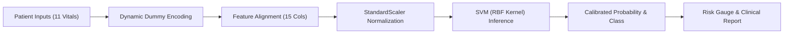

# ❤️ CardioSense AI — Cardiovascular Risk Stratification Dashboard

[](https://www.python.org/)
[](https://streamlit.io/)
[-F7931E?logo=scikitlearn&logoColor=white)](https://scikit-learn.org/)
[](#-model-benchmarking--evaluation)
[](#-model-benchmarking--evaluation)
[](LICENSE)

An interactive, clinical-grade machine learning application engineered for cardiovascular disease risk stratification. Powered by a trained **Support Vector Machine with a Radial Basis Function (RBF) Kernel**, the platform delivers real-time risk predictions, interactive what-if clinical intervention simulations, batch patient screening, and downloadable assessment reports.

---

## 🌟 Key Capabilities

- **Clinical Decision Support UI**: Modern, uncluttered healthcare interface with physiological validation ranges and pre-filled patient test profiles.
- **Calibrated Risk Gauge**: Interactive Plotly radial gauge displaying continuous probability scores (0%–100%) against a 50% decision boundary.
- **💡 What-If Sensitivity Simulator**: Dynamically simulate clinical interventions (e.g., blood pressure reduction, cholesterol control) to observe immediate risk score shifts.
- **📁 Batch Patient Screening**: Process entire cohorts via CSV upload with automated risk flagging and one-click export.
- **📄 Downloadable Clinical Reports**: Instant export of timestamped patient assessments in structured format.
- **🔒 Local & Confidential**: Pure in-memory inference without external API calls or permanent biometric data storage.

---

## 📊 Model Benchmarking & Evaluation

During empirical evaluation across 5 classification algorithms, the **Support Vector Machine (RBF Kernel)** demonstrated the highest generalization accuracy and balanced F1-score:

| Model | Architecture | Accuracy | F1 Score | Status |
| :--- | :--- | :---: | :---: | :---: |
| **SVM (RBF Kernel)** | **Non-Linear Kernel Machine** | **88.04%** | **89.62%** | ⭐ **Production Model** |
| Naive Bayes | Probabilistic Classifier | 86.41% | 87.92% | Evaluated |
| Logistic Regression | Linear Model | 85.33% | 86.96% | Baseline |
| K-Nearest Neighbors (KNN) | Distance-based Metric | 84.78% | 86.41% | Evaluated |
| Decision Tree | Recursive Partitioning | 79.35% | 81.90% | Evaluated |

### Why SVM with RBF Kernel Won:
1. **Non-Linear Feature Interaction**: Cardiovascular markers exhibit complex non-linear relationships. The RBF kernel projects the 15-dimensional feature space into an infinite-dimensional Hilbert space, capturing boundaries linear models miss.
2. **Maximum Margin Generalization**: Unlike single Decision Trees which overfitted locally, SVM maximizes geometric margins between opposing support vectors.
3. **Harmonized Scaling**: Coupling with a fitted `StandardScaler` ($\mu = 0, \sigma = 1$) ensures distance calculations are not dominated by large-scale attributes (such as Cholesterol).

---

## 🏗️ System Architecture & Inference Flow



---

## 📁 Repository Structure

```
HeartDiseaseProject/
│
├── app.py                      # Multi-page Streamlit application & clinical UI
├── SVM_heart.pkl               # Trained Support Vector Machine (RBF Kernel) model
├── scaler.pkl                  # Fitted StandardScaler feature transformer
├── columns.pkl                 # Exact 15-dimension training feature schema
├── requirements.txt            # Python dependencies
├── sample_patients.csv         # Ready-to-use sample cohort for batch screening
├── LICENSE                     # MIT Open Source License
├── .gitignore                  # Git repository exclusion rules
│
├── .streamlit/
│   └── config.toml             # Custom clinical theme and styling configuration
│
├── assets/
│   └── styles.css              # Custom healthcare UI stylesheet & card components
│
└── utils/
    └── preprocessing.py        # Artifact loading, validation, feature encoding & reports
```

---

## 🚀 Quickstart & Installation

### 1. Clone the Repository
```bash
git clone https://github.com/your-username/HeartDiseaseProject.git
cd HeartDiseaseProject
```

### 2. Set Up a Virtual Environment (Recommended)
```bash
# Windows
python -m venv venv
.\venv\Scripts\activate

# macOS / Linux
python3 -m venv venv
source venv/bin/activate
```

### 3. Install Dependencies
```bash
pip install -r requirements.txt
```

### 4. Launch the Web Application
```bash
python -m streamlit run app.py
```

The application will open in your browser at `http://localhost:8501`.

---

## 🧪 Testing the Application

### Option A: 1-Click Patient Presets
On the **❤️ Prediction** page, expand **"⚡ Quick Test Profiles"** to load pre-configured test cases:
- **🟢 Low-Risk Profile**: 32-year-old female with normal vitals and upsloping ST segment ($\approx 6.8\%$ risk).
- **🔴 Elevated-Risk Profile**: 58-year-old male with asymptomatic chest pain and flat ST slope ($\approx 94.0\%$ risk).

### Option B: Batch Screening
Switch to the **"📁 Batch Evaluation (CSV)"** tab, click **"📥 Download Sample CSV Template"** (or upload [`sample_patients.csv`](sample_patients.csv)), and click **"⚡ Execute Batch Risk Stratification"**.

---

## ⚠️ Medical & Ethical Disclaimer

> **IMPORTANT:** This application is engineered exclusively for **educational, academic, and research purposes**. It is **not** a certified medical diagnostic device and does not provide clinical diagnoses. Predictions produced by the machine learning model represent statistical risk associations. Always seek the advice of a qualified physician or healthcare provider regarding cardiovascular concerns.

---

## 📄 License

This project is licensed under the [MIT License](LICENSE).
